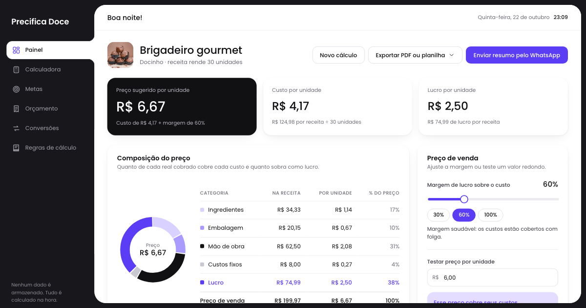

# Precifica Doce

Calculadora de preços para quem produz e vende doces. A partir dos custos de uma receita (ingredientes, embalagem, mão de obra e custos fixos) e da margem desejada, o app mostra o preço sugerido por unidade e explica de onde vem cada centavo.



## Funcionalidades

| Tela | O que faz |
|---|---|
| **Painel** | Preço sugerido, custo e lucro por unidade; gráfico de composição do preço; ajuste de margem; "testar preço" com aviso de prejuízo; os cinco maiores custos. |
| **Calculadora** | Cinco etapas guiadas (produto, ingredientes, embalagem, mão de obra e custos fixos, margem), com validação e modelos prontos (brigadeiro, bolo de pote, cupcake, brownie) que podem ser editados. |
| **Metas** | Quantas unidades vender para atingir uma meta de lucro ou de faturamento, por semana e por dia, com comparativo entre margens. |
| **Orçamento** | Pedido de um cliente com vários itens, desconto, taxa de entrega e sinal; exporta PDF e abre o WhatsApp com a mensagem pronta. |
| **Conversões** | Medidas caseiras em gramas, comparação de embalagens (preço por 100 g e economia por receita) e ajuste da receita para outro rendimento. |
| **Regras de cálculo** | Todas as fórmulas usadas, com exemplos calculados a partir do cálculo atual. |

### Exportações

- **PDF**: ficha técnica com indicadores, composição do preço e todos os itens de custo; orçamento com itens e totais.
- **Planilha Excel (.xlsx)**: abas Resumo, Ingredientes, Embalagem e extras, e Mão de obra e custos, com fórmulas nos totais.
- **WhatsApp**: abre o WhatsApp com o resumo ou o orçamento já formatado. Quem envia é a pessoa, depois de revisar.

As bibliotecas de PDF e Excel só são carregadas quando alguém pede o arquivo.

## Sem banco de dados

O app não tem login, servidor nem armazenamento. Tudo é calculado na hora, no navegador, e nada é enviado ou salvo. Ao abrir, o painel mostra um exemplo (brigadeiro gourmet) para demonstração; "Novo cálculo" limpa tudo, e recarregar a página volta ao exemplo.

## Regras de cálculo

| Valor | Fórmula |
|---|---|
| Custo do ingrediente | preço do pacote ÷ tamanho do pacote × quantidade usada |
| Embalagem e extras | custo unitário × quantidade |
| Mão de obra | horas de preparo × valor da hora |
| Custos fixos | gás + energia + outros, ou % × (ingredientes + embalagem) |
| Custo por unidade | custo da receita ÷ rendimento |
| Preço sugerido | custo por unidade × (1 + margem sobre o custo) |
| Unidades para a meta | meta ÷ lucro (ou preço) por unidade, arredondado para cima |
| Total do orçamento | subtotal − desconto + taxa de entrega |

Os cálculos usam os valores completos; só a exibição é arredondada para centavos.

## Tecnologias

- [React 18](https://react.dev) e [Vite 6](https://vite.dev)
- CSS próprio, sem framework, com variáveis para cores e espaçamentos
- [jsPDF](https://github.com/parallax/jsPDF) e [jsPDF-AutoTable](https://github.com/simonbengtsson/jsPDF-AutoTable) para os PDFs
- [ExcelJS](https://github.com/exceljs/exceljs) para a planilha
- Fonte [Poppins](https://fonts.google.com/specimen/Poppins)

## Como rodar

Requer Node.js 18 ou mais recente.

```bash
npm install
npm run dev      # servidor de desenvolvimento em http://localhost:5173
npm run build    # versão de produção na pasta dist/
npm run preview  # serve a versão de produção localmente
```

## Estrutura

```
src/
  App.jsx              rotas (por hash) e estrutura da página
  AppState.jsx         estado em memória: cálculo, meta, orçamento e avisos
  styles.css           visual completo e versões para tablet e celular
  components/          menu, barra superior, campos, gráfico, menu de exportação
  pages/               Painel, Calculadora, Metas, Orçamento, Conversões, Regras
  lib/
    calc.js            regras de cálculo usadas em todas as telas e arquivos
    models.js          modelos de produto prontos
    conversions.js     tabela de medidas caseiras
    messages.js        textos para o WhatsApp
    exporters.js       geração de PDF e planilha
    format.js          moeda, números e datas em pt-BR
public/images/         fotos dos produtos
```
